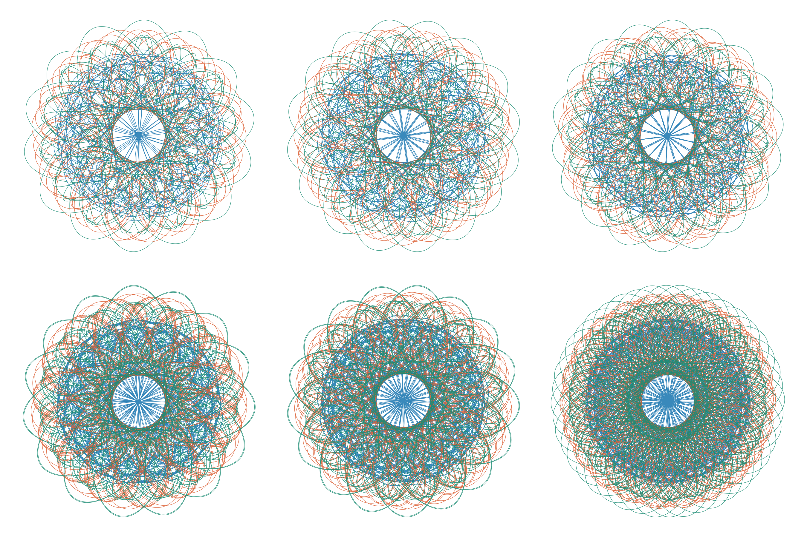

# Three-Body Stable Solution Research

Using a new advanced algorithm, we publish 139 numerically verified periodic solutions of the Newtonian three-body problem that are linearly stable under spatial perturbations.

